# Архитектура UniversalAgent

## Компоненты

```mermaid
graph TD
    CLI[CLI / API Clients] --> API[FastAPI Server]
    API --> Graph[LangGraph Orchestrator]
    Graph --> SQLite[(SQLite DB)]
    Graph --> Policy[Approval Policy Engine]
    Graph --> Evidence[Evidence Collector]
    Graph --> Worker[Isolated TMUX Worker]
    Worker --> AGY[AGY Adapter]
```

- **LangGraph**: Ядро оркестрации. Управляет конечным автоматом (State Machine) задач, обеспечивая переходы между состояниями (создана, выполняется, ожидает подтверждения, завершена).
- **SQLite**: Хранилище состояния графа. Позволяет переживать перезапуски сервиса и сохранять историю выполнения (checkpointing).
- **FastAPI**: REST API интерфейс для взаимодействия с агентом.
- **Approval Policy**: Подсистема безопасности. Перехватывает опасные команды (например, модификацию файловой системы или submit) и приостанавливает выполнение до получения явного разрешения (`approve` / `deny`).
- **Evidence**: Модуль сбора доказательств (артефактов, логов) для аудита.
- **Workers**: Изолированные исполнители (через `tmux`), гарантирующие, что задачи агента не сломают основную систему. Ограничены в правах.
- **AGY Adapter**: Специфичный коннектор для взаимодействия со вторичными worker-процессами (detect-only для OpenHands, ручной режим).
